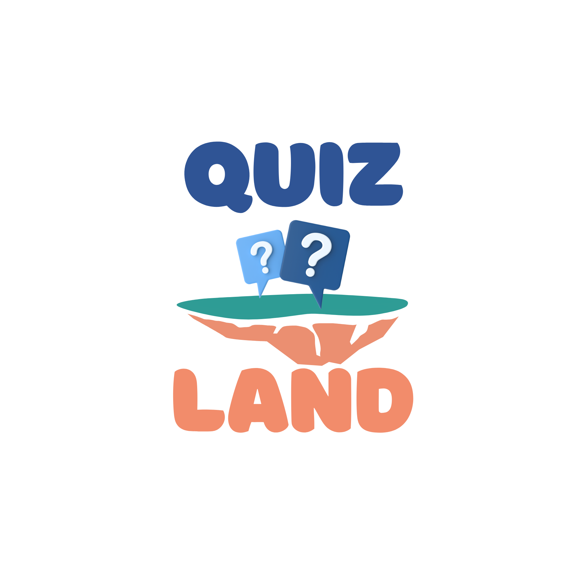
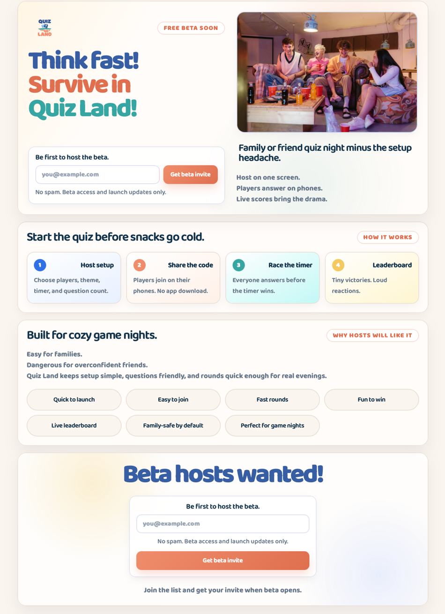
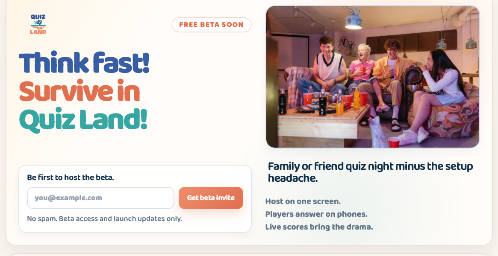
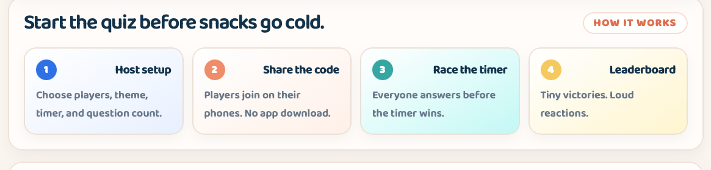
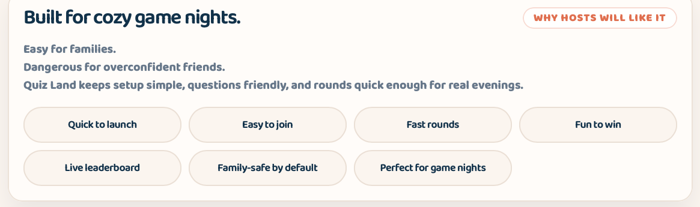
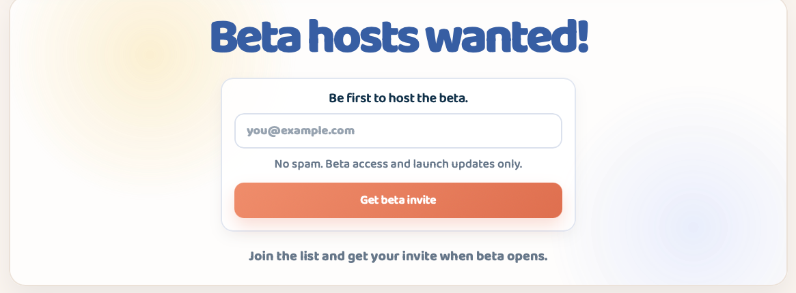

# Quiz Land UI Brand Guideline Book

**Source of truth:** the latest uploaded landing page archive and screenshot  
**Core slogan:** Think fast! Survive in Quiz Land!

This version deliberately uses only the visual language visible in the current landing page screenshot and the CSS from the latest uploaded archive. No older Quiz Land components or independently invented UI specimens are used.

---

## 1. Visual source of truth

Use this landing page screenshot as the primary visual reference for UI styling, component proportions, pills, cards, forms, imagery, spacing, and color mood.

> Do not substitute these components with the older blue-outline app screens or previous generated card specimens.



---

## 2. Brand direction

Quiz Land is playful, cozy, fast, and slightly chaotic in a friendly way. The UI should feel like an easy family or friend game night, not a corporate quiz dashboard.

| Token / class | Definition from current landing CSS |
|---|---|
| Brand promise | Make group evenings more fun with fast browser quizzes. |
| Core slogan | Think fast! Survive in Quiz Land! |
| Tone | Short, punchy, warm, playful, and direct. |
| UI mood | Soft cream background, round cards, friendly pills, vivid logo colors, gentle shadows. |
| Avoid | Dense admin-like layouts, sharp rectangles, heavy borders, cold gray UI, and old component styles. |

---

## 3. Color system

Use the CSS custom properties below as the source of truth. Do not introduce new primary colors unless the CSS tokens are updated first.

| Token / class | Definition from current landing CSS |
|---|---|
| `--bg` | `#fbf5ef` |
| `--panel` | `#fffdf9` |
| `--ink` | `#12324a` |
| `--muted` | `#667689` |
| `--line` | `#eadfd5` |
| `--blue` | `#375ea3` |
| `--blue-action` | `#2f70e6` |
| `--blue-soft` | `#e8f0ff` |
| `--coral` | `#ef8d6b` |
| `--coral-dark` | `#df6f4f` |
| `--coral-soft` | `#fff0e8` |
| `--yellow` | `#f4c95f` |
| `--yellow-soft` | `#fff5cf` |
| `--teal` | `#35a6a2` |
| `--teal-soft` | `#c3f8f5` |

### Shape and depth tokens

| Token / class | Definition from current landing CSS |
|---|---|
| `--shadow` | `0 18px 40px rgba(31, 44, 58, 0.08)` |
| `--shadow-soft` | `0 8px 20px rgba(31, 44, 58, 0.05)` |
| `--radius` | `24px` |
| `--radius-sm` | `14px` |

---

## 4. Typography

The latest uploaded CSS imports Inter, Nunito Sans, and Baloo 2, but the active body font is Baloo 2. This gives the landing page its rounded, playful personality.

```css
@import url("https://fonts.googleapis.com/css2?family=Inter:wght@400;500;600;700;800&family=Nunito+Sans:wght@400;500;600;700;800&family=Baloo+2:wght@400;500;600;700;800&display=swap");

body {
  font-family: "Baloo 2", ui-sans-serif, system-ui, -apple-system, BlinkMacSystemFont, "Segoe UI", sans-serif;
}
```

| Token / class | Definition from current landing CSS |
|---|---|
| Hero H1 | `clamp(42px, 5.2vw, 72px)`, line-height `0.94`, weight `800`, letter-spacing `-0.06em`. |
| H2 | `clamp(24px, 2.8vw, 34px)`, line-height `1.05`, weight `600`, letter-spacing `-0.04em`. |
| H3 | `20px` desktop / `20px` mobile, line-height `1.08`, weight `700`. |
| Body/support text | Muted color, rounded Baloo voice, short lines. Avoid long paragraphs. |
| Hero title colors | `.title-blue`, `.title-coral`, `.title-teal` should be used exactly as in the screenshot. |

---

## 5. Page layout and spacing

| Token / class | Definition from current landing CSS |
|---|---|
| `.page` | `width: min(1140px, calc(100% - 28px)); margin: auto; padding: 24px 0 38px;` |
| `.hero-panel` | Two-column grid on desktop; gap `32px`; padding `28px`; radius `24px`; cream panel. |
| `.section` | Reusable content panel; display grid; gap `22px`; margin-top `18px`; padding `24px`. |
| `.final-cta` | Centered call-to-action block with radial background accents and `24px` internal gap. |
| Mobile breakpoint | At max-width `640px`: panels use `18px` padding, `20px` radius, forms/buttons stack, grids become one column. |

---

## 6. Component examples from current screenshot

The following examples are cropped directly from the provided screenshot. They are not recreated UI specimens.

### Hero panel

Logo, free-beta pill, multicolor hero title, email form, image card, and subtitle stack.



### How-it-works cards

Small step cards use soft variant backgrounds, rounded corners, and compact copy.



### Benefit pills

Benefit labels use large rounded pill shapes with centered text and soft beige treatment.



### Final CTA

CTA reuses the same form style, centered composition, and large blue headline.



---

## 7. UI component specifications

When building new screens, reuse these component classes and values. If a new class is needed, derive it from the closest class below rather than inventing a new style.

### 7.1 Panels

```css
.hero-panel,
.section,
.final-cta {
  border: 1px solid rgba(234, 223, 213, 0.92);
  border-radius: var(--radius);
  background: rgba(255, 253, 249, 0.92);
  box-shadow: var(--shadow);
}
```

### 7.2 Eyebrow pill

Used for section labels such as `FREE BETA SOON`, `HOW IT WORKS`, and `WHY HOSTS WILL LIKE IT`. It is a compact pill with coral text and a white translucent background.

```css
.eyebrow {
  width: fit-content;
  min-height: 36px;
  display: inline-flex;
  align-items: center;
  padding: 0 16px;
  border-radius: 999px;
  border: 1px solid rgba(223, 111, 79, 0.25);
  background: rgba(255, 255, 255, 0.86);
  color: var(--coral-dark);
  font-size: 12px;
  font-weight: 950;
  text-transform: uppercase;
  letter-spacing: 0.06em;
}
```

### 7.3 Benefit pills / labels

Benefit pills are represented by `.proof-list div` and `.eyebrow-label` in the current page. Use centered text, rounded `32px` pills, soft page background, and line-colored border. Do not use the older blue-outlined pill style here.

```css
.proof-list {
  display: grid;
  grid-template-columns: repeat(4, 1fr);
  gap: 12px;
  align-items: center;
}

.proof-list div {
  min-height: 60px;
  display: flex;
  align-items: center;
  justify-content: center;
  text-align: center;
  padding: 14px;
  border: 1px solid var(--line);
  border-radius: 32px;
  background: var(--bg);
  color: var(--ink);
}
```

### 7.4 How-it-works cards

Cards use compact padding, rounded corners, soft shadow, a numbered circular badge, and variant background tints.

```css
.info-card {
  display: grid;
  gap: 10px;
  padding: 18px;
  border: 1px solid rgba(234, 223, 213, 0.95);
  border-radius: 20px;
  background: #ffffff;
  box-shadow: var(--shadow-soft);
}

.card-blue {
  background: linear-gradient(150deg, #ffffff, var(--blue-soft));
}

.card-coral {
  background: linear-gradient(150deg, #ffffff, var(--coral-soft));
}

.card-teal {
  background: linear-gradient(150deg, #ffffff, var(--teal-soft));
}

.card-yellow {
  background: linear-gradient(150deg, #ffffff, var(--yellow-soft));
}
```

### 7.5 Step number badge

```css
.step-number {
  display: grid;
  width: 34px;
  height: 34px;
  place-items: center;
  border-radius: 999px;
  background: var(--blue-action);
  color: #ffffff;
  font-size: 14px;
  font-weight: 950;
}
```

### 7.6 Forms and CTA button

The form is a soft white card with pale blue border and subtle shadow. The primary CTA is coral gradient, rounded, and should not be replaced with blue unless a new CSS token is approved.

```css
.hero-form {
  display: grid;
  gap: 10px;
  width: 100%;
  padding: 18px;
  border: 1px solid rgba(49, 91, 156, 0.15);
  border-radius: 18px;
  background: rgba(255, 255, 255, 0.86);
  box-shadow: var(--shadow-soft);
}

.primary-button {
  min-height: 52px;
  border-radius: var(--radius-sm);
  padding: 0 20px;
  background: linear-gradient(135deg, var(--coral), var(--coral-dark));
  color: #ffffff;
}
```

---

## 8. Imagery and logo usage

Use the latest logo from the archive and the real friends-night photograph style for landing and marketing pages. Avoid invented placeholder cards when a real app/product image or lifestyle image is expected.

| Token / class | Definition from current landing CSS |
|---|---|
| Logo | Use `assets/logo.png` from the latest archive. Default hero width is `92px`, `84px` below `980px`, `72px` below `640px`. |
| Hero image | Use a real family/friend quiz-night image inside `.family-image-card`. Rounded `22px` card, pale blue border, soft shadow. |
| Mood | Warm indoor, friends/family, laughter, phones, casual game night. Avoid corporate stock photos and cold device-only mockups. |
| Alt text | Describe the social scene and quiz context clearly. |

```css
.hero-logo {
  width: 92px;
}

.family-image-card {
  overflow: hidden;
  border: 1px solid rgba(49, 91, 156, 0.18);
  border-radius: 22px;
  background: linear-gradient(180deg, rgba(232, 240, 255, 0.78), rgba(255, 255, 255, 0.92));
  box-shadow: var(--shadow-soft);
}
```

---

## 9. Responsive behavior

| Token / class | Definition from current landing CSS |
|---|---|
| `<= 980px` | Hero switches from two columns to one column. Steps grid becomes 2 columns. Logo becomes `84px`. |
| `<= 640px` | Panels use `18px` padding and `20px` radius. Steps and proof-list become 1 column. CTA button becomes full width. |
| Mobile typography | H1 fixed at `42px`, H2 at `26px`, H3 at `20px`. Keep copy short to prevent awkward wrapping. |

```css
@media (max-width: 640px) {
  .hero-panel,
  .section,
  .final-cta {
    padding: 18px;
    border-radius: 20px;
  }

  .steps-grid,
  .proof-list {
    grid-template-columns: 1fr;
  }
}
```

---

## 10. Designer and developer QA checklist

- Use only CSS tokens and class behavior from the latest landing archive unless the brand system is intentionally updated.
- Benefit pills must match the screenshot: centered text, soft beige fill, subtle line border, rounded pill shape.
- How-it-works cards must use `.info-card` plus one of the four card color modifiers.
- Primary CTAs must use the coral gradient button style.
- Hero typography must keep the three-color title treatment: blue, coral, teal.
- Do not reuse old in-game/admin page cards as marketing landing components.
- Check mobile at `640px` and below: one-column stacks, full-width buttons, no horizontal overflow.
- Use short, punchy copy. Avoid explanatory paragraphs where labels or one-liners work.
